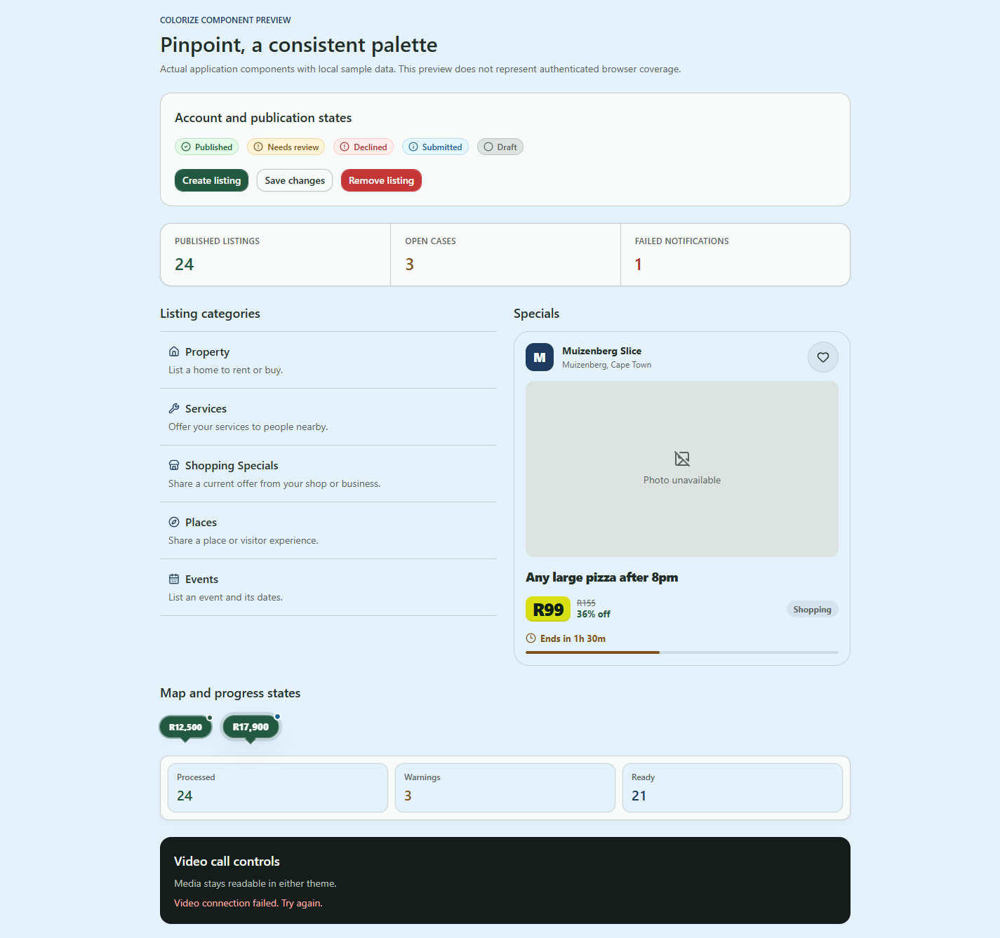
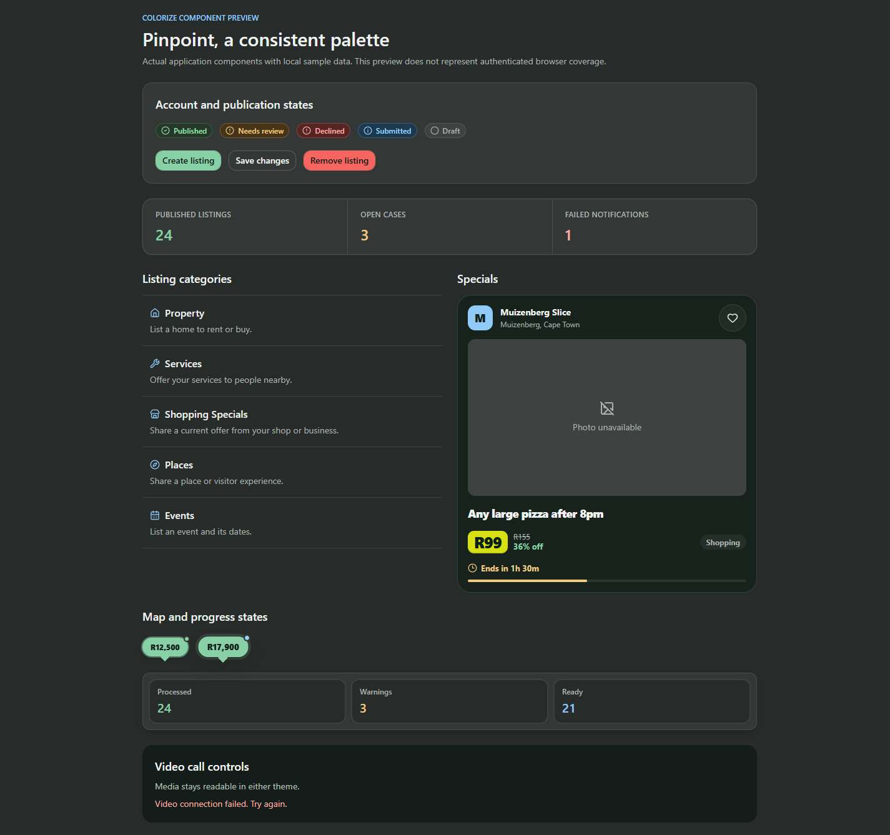
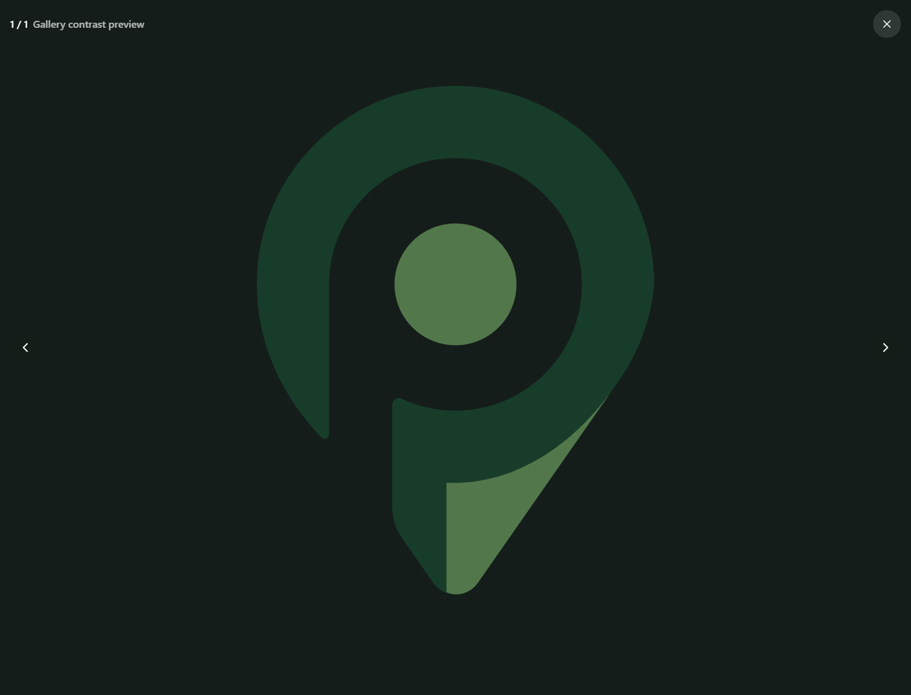
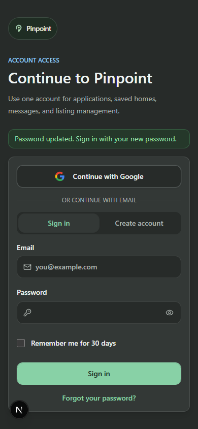

# Pinpoint colorize, 13 October 2026

Applied Impeccable's restrained product color strategy across the shared UI, preserving the supplied light-blue canvas, forest primary actions, navy accents, existing layouts, URLs, and behavior. This is a local implementation; it has not been deployed.

## What changed

- Stronger supporting-text contrast on the blue canvas.
- Complete success, warning, error, and information palettes in light and dark themes. Fixed the missing dark success surface and dark destructive-text contrast.
- Shared form-error colors for sign-in, signup, password recovery, and applicant actions.
- Navy category icons, supporting admin links, and Specials identity marks. Specials timing uses the shared semantic palette, with the existing lime price label retained.
- Warning colors for stale drafts and unavailable map previews; error colors for failed requests and notification feedback.
- Stable dark media surfaces and readable text for image galleries, photo counts, calls, and video controls.

The [scoped patch](colorize.patch) compares this pass against the existing working files, retaining earlier work. [Changed files](changed-files.json) lists the 45 edited source/design files. [DESIGN.md](../../DESIGN.md) records the color roles.

## Coverage and verification

| Check | Result |
|---|---|
| Source coverage | All 91 page routes, 258 UI files, and 480 local dependencies, including inherited layouts and error/loading screens |
| Public browser checks | 40 route/theme/viewport combinations at 390px and 1440px, all HTTP 200, no horizontal overflow or uncaught page errors |
| Final affected-screen refresh | Services and Specials checked again in both themes and viewports after the final feedback-color changes |
| Component previews | Actual application components with local sample data: categories, statuses, admin metrics, Specials, map markers, progress, and gallery controls; both themes at 390px and 1440px |
| Signup interactions | Password mismatch and generated-password recovery at 320px in both themes, no account created |
| Component regressions | 108 suites / 547 tests passed; a subsequent pass over changed editors, services, discovery, and notifications passed 69 suites / 480 tests. These runs overlap and are not a unique combined total |
| Contrast | 10 theme tests passed, reading actual CSS tokens; body/state/action text >=4.5:1, focus rings >=3:1 |
| TypeScript and scoped ESLint | Passed |
| Production build | Isolated Next.js production build passed, 122 static pages generated |
| JavaScript budgets | First-load budget passed for 93 routes; discovery initial JS 297.1 KB compressed, within the 300 KB budget |
| Patch verification | Reverse application check passed against the current source |

The route inventory is in [screen-coverage.md](screen-coverage.md); [source-coverage.json](source-coverage.json) retains the dependency and color-role details. Browser evidence is in [browser-results.json](browser-results.json), [browser-refresh-results.json](browser-refresh-results.json), [component-preview-results.json](component-preview-results.json), and [interaction-results.json](interaction-results.json).

## Visual evidence

The component previews below use application components and sample data. They are not authenticated screens.

## Remaining verification limits

Protected routes were reviewed through their source and shared components. No signed-in or admin session was available for complete populated-screen journeys. The local preview has no configured map and several data requests fail, so map tiles, populated real listings, blog content, and authenticated actions are not proven by these checks. Populated cards were checked in the labelled component previews. Production deployment and deployed visual verification remain outstanding.

Official Google logo colors, QR-code backgrounds, and existing WebGL map color literals were preserved. The build reports the existing deprecated middleware convention; this color pass does not migrate it.
